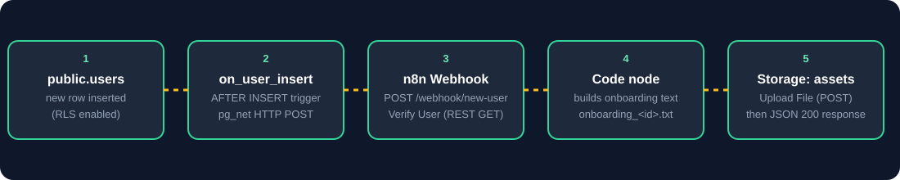

<p align="center">
  
</p>

<h1 align="center">Database Webhook-Driven File Asset Processor</h1>
<h3 align="center">Tayana Academy · Lesson 5 — Supabase Integration</h3>

<p align="center">
  <a href="https://www.loom.com/share/249aa23c99e342879157a28312eec379"></a>
  <a href="https://github.com/shaikshahid777/supabase-webhook-file-asset-processor"></a>
  <a href="docs/setup-guide.md"></a>
  <a href="docs/testing.md"></a>
</p>

<p align="center">
  
  
  
  
  
</p>

This project demonstrates an event-driven workflow that connects Supabase PostgreSQL, n8n Cloud, and Supabase Storage to create a personalized onboarding text file when a new user record is inserted.

<p align="center">
  
</p>

## Quick Navigation

| | | |
|---|---|---|
| [Demo Video](#demo-video) | [Project Components](#project-components) | [Workflow Overview](#workflow-overview) |
| [Database Schema](#database-schema) | [Trigger and Webhook](#trigger-and-webhook) | [Generated File](#generated-file) |
| [Repository Structure](#repository-structure) | [Security Notes](#security-notes) | [Test Status](#test-status) |
| [Known Limitations](#known-limitations) | [Troubleshooting](#troubleshooting) | [Documentation Index](#documentation-index) |

## Demo Video

<p align="center">
  <a href="https://www.loom.com/share/249aa23c99e342879157a28312eec379"></a>
</p>

> **Note:** The Loom recording presents the previously configured workflow. A new live test was not performed during that recording.

## Project Components

- **Supabase Database:** `public.users` stores user ID, name, email, role, and creation timestamp.
- **Row-Level Security (RLS):** SELECT and INSERT access are controlled by table policies. Anonymous inserts are intended to be blocked by the authenticated-only INSERT policy.
- **PostgreSQL Trigger:** `on_user_insert` runs after a row is inserted and calls `public.notify_new_user()`.
- **pg_net:** The trigger function sends an HTTP POST event to the n8n Cloud production webhook.
- **n8n Cloud:** The `User Onboarding Processor` workflow receives the event, verifies the user through the Supabase REST API, builds onboarding text, uploads the file, and returns a response.
- **Supabase Storage:** The generated file is stored in the public `assets` bucket.

## Workflow Overview

1. **Webhook:** Receives a POST event for a new user.
2. **Verify User:** Queries the Supabase REST API (`/rest/v1/users?id=eq.<id>&select=*`) to confirm the inserted record. This is the REST-based verification step (the assessment allows "SQL query or REST API query").
3. **Code:** Builds a personalized onboarding text file with the user details. Throws a clear error if the user is not found.
4. **Upload File:** Uploads the generated `.txt` file into the `assets` bucket.
5. **Respond to Webhook:** Returns a success status and the generated filename.

Details: [`docs/architecture.md`](docs/architecture.md) and [`n8n/README.md`](n8n/README.md).

## Database Schema

The `public.users` table contains:

| Column       | Purpose                         |
|--------------|---------------------------------|
| `id`         | Identity primary key            |
| `name`       | User name                       |
| `email`      | User email address              |
| `role`       | User role; defaults to `member` |
| `created_at` | Creation timestamp              |

SQL: [`supabase/schema.sql`](supabase/schema.sql)

## Trigger and Webhook

The PostgreSQL trigger is configured as an `AFTER INSERT` trigger on `public.users`. Its function sends an event payload containing the event type, table, schema, inserted record, and `old_record: null` to the n8n production webhook.

The old Database Webhooks interface was not available in the dashboard used for this project, so the integration uses a PostgreSQL trigger and the `pg_net` extension instead.

SQL: [`supabase/webhook-trigger.sql`](supabase/webhook-trigger.sql) (the webhook URL is a placeholder; use your own).

## Generated File

The workflow generates a file in the format:

`onboarding_<user-id>.txt`

The file contains the user's name, ID, email, role, and creation timestamp. The public URL follows this pattern:

`https://<supabase-project-ref>.supabase.co/storage/v1/object/public/assets/onboarding_<user-id>.txt`

## Repository Structure

```text
.
├── README.md
├── LICENSE
├── LMS_DESCRIPTION.md
├── .gitignore
├── .env.example
├── assets/
│   ├── banner.svg
│   └── flow.svg
├── docs/
│   ├── architecture.md
│   ├── setup-guide.md
│   ├── security-and-rls.md
│   └── testing.md
├── supabase/
│   ├── schema.sql
│   ├── rls-policies.sql
│   └── webhook-trigger.sql
└── n8n/
    └── README.md
```

> `n8n/workflow.json` is **not** included yet. See [`n8n/README.md`](n8n/README.md) for how to export it and remove secrets first.

## Quick Start

> Follow the full guide in [`docs/setup-guide.md`](docs/setup-guide.md). Summary:

1. Create a Supabase project, then run `supabase/schema.sql` and `supabase/rls-policies.sql` in the SQL Editor.
2. Create a **public** Storage bucket named `assets`.
3. Build the 5-node workflow in n8n Cloud (see [`n8n/README.md`](n8n/README.md)) and **publish** it.
4. Put your n8n production webhook URL into `supabase/webhook-trigger.sql` and run it.
5. Insert a test row into `public.users` and check the n8n **Executions** tab and the `assets` bucket.

## Security Notes

- Row-Level Security is enabled on `public.users`.
- The authenticated-only INSERT policy is intended to reject anonymous inserts.
- The workflow uses privileged credentials for server-side verification and storage uploads. **Never commit service-role keys, access tokens, database passwords, or other secrets to this repository.**
- Use environment variables or n8n credentials to store sensitive values.
- The `assets` bucket is public, so do not upload sensitive personal data to it.

More: [`docs/security-and-rls.md`](docs/security-and-rls.md).

## Test Status

The project was previously tested: inserting a user named Asha Rao created `onboarding_1.txt`, and the n8n execution succeeded. The linked Loom recording shows the previously configured workflow; it does not include a new live test performed during that recording. Run a fresh end-to-end test before claiming that a new execution has been verified.

Full breakdown of what is verified and what is not: [`docs/testing.md`](docs/testing.md).

## Known Limitations

- The webhook endpoint has no authentication, so anyone who knows the URL could send it a request. The workflow re-reads the user by `id` from Supabase before doing anything, which limits what a fake payload can do, but a shared secret header is recommended for real use.
- The `assets` bucket is public and filenames are sequential (`onboarding_1.txt`, `onboarding_2.txt`, ...), so generated files containing names and emails can be guessed and opened by anyone. Acceptable for this training exercise only.
- The `Allow public SELECT` policy lets anyone with the anon key read every row of `public.users`.
- In the author's n8n workflow the service-role key is stored in node header parameters, not in an n8n credential. Move it into a Header Auth credential before any real use.
- If the webhook delivery fails, the database insert still succeeds (pg_net is asynchronous), and there is no retry logic in this project.
- Free-tier Supabase projects pause after a period of inactivity.

## Troubleshooting

<details>
<summary><b>Webhook never arrives in n8n</b></summary>

- Is the workflow **published**? Production URLs (`/webhook/...`) only work for published workflows.
- Does the trigger use the production URL, not `/webhook-test/...`?
- Check Supabase table `net._http_response` (pg_net response log) for the HTTP status of the call.
</details>

<details>
<summary><b>401 / 403 from Supabase in the Verify User or Upload File node</b></summary>

- Both `apikey` and `Authorization: Bearer <key>` must be present.
- Make sure there is no trailing space or line break after the key (this happened once during the build and was fixed).
</details>

<details>
<summary><b>Upload File fails</b></summary>

- The bucket name must be exactly `assets`.
- `Content-Type` must be `text/plain` and the body must be raw text.
- Set header `x-upsert: true` if re-uploading the same filename.
</details>

<details>
<summary><b>Execution fails with "User not found in Supabase for id ..."</b></summary>

The Code node's guard is working: the REST query returned no row for that `id`. Check that the row exists and that you are using the service-role key in Verify User.
</details>

## Documentation Index

| Document | What it covers |
|---|---|
| [`docs/architecture.md`](docs/architecture.md) | Components, data flow, payload shape |
| [`docs/setup-guide.md`](docs/setup-guide.md) | Step-by-step setup for Supabase, n8n, trigger, Storage |
| [`docs/security-and-rls.md`](docs/security-and-rls.md) | RLS policies, key handling, limitations |
| [`docs/testing.md`](docs/testing.md) | What was and was not tested |
| [`n8n/README.md`](n8n/README.md) | The five n8n nodes and how to export the workflow safely |

## Technologies

- Supabase PostgreSQL
- Row-Level Security (RLS)
- PostgreSQL triggers
- `pg_net`
- n8n Cloud
- Supabase REST API
- Supabase Storage
- JavaScript

## Project Deliverables

- Loom demo: linked above
- Public GitHub repository: project documentation
- Supabase database and trigger configuration
- n8n workflow for verification, file generation, upload, and webhook response

## License

Released under the [MIT License](LICENSE) for educational use.
