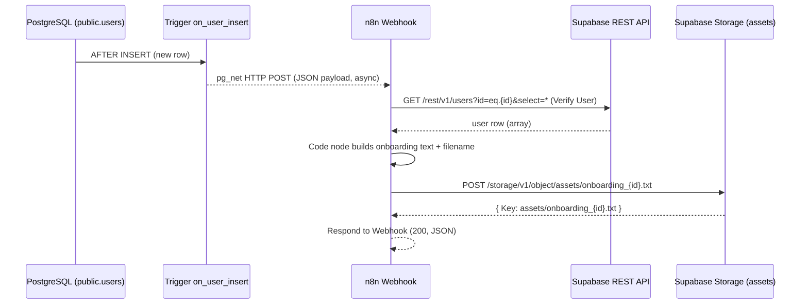

# Architecture


## Components

| Component | Role |
|---|---|
| `public.users` (PostgreSQL) | Source table. A new row starts the process. RLS is enabled. |
| `on_user_insert` trigger + `public.notify_new_user()` | `AFTER INSERT ... FOR EACH ROW`. Builds a JSON payload and calls `net.http_post`. |
| `pg_net` extension | Sends the HTTP POST asynchronously from the database. |
| n8n Cloud workflow `User Onboarding Processor` | Receives the event, verifies the user, builds the file, uploads it, responds. |
| Supabase REST API (PostgREST) | Used by n8n to re-read the inserted user by `id`. |
| Supabase Storage bucket `assets` (public) | Holds the generated `onboarding_<id>.txt` files. |

## Sequence



> The response of the n8n workflow goes back to `pg_net`, not to the SQL client that inserted the row, because the call is asynchronous.

## Webhook payload sent by the trigger

```json
{
  "type": "INSERT",
  "table": "users",
  "schema": "public",
  "record": {
    "id": 1,
    "name": "Asha Rao",
    "email": "asha@example.com",
    "role": "developer",
    "created_at": "2026-10-21T06:13:17.396142+00:00"
  },
  "old_record": null
}
```

(Example values come from the first test row; the payload shape is built by `jsonb_build_object` in `supabase/webhook-trigger.sql`.)

n8n receives this as the Webhook node output, so the inserted id is read as `$json.body.record.id`.

## Why a SQL trigger instead of the Database Webhooks screen?

The Database Webhooks screen was not available in the Supabase dashboard used for this project. The Supabase feature is built on `pg_net` triggers, so the same behaviour is created directly with SQL.

## Asynchronous behaviour

`pg_net` sends requests after the transaction and does not roll back the insert if delivery fails. A failed webhook therefore means a saved row but no generated file. (This failure case has **not** been tested in this project; see `docs/testing.md`.)
